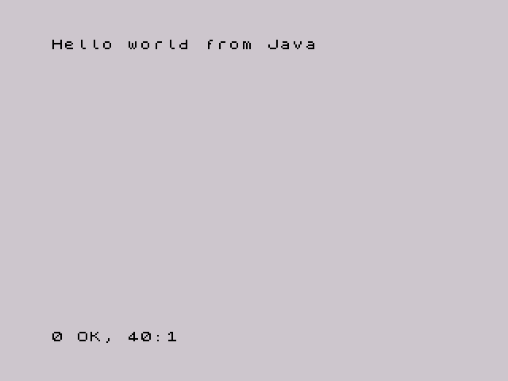
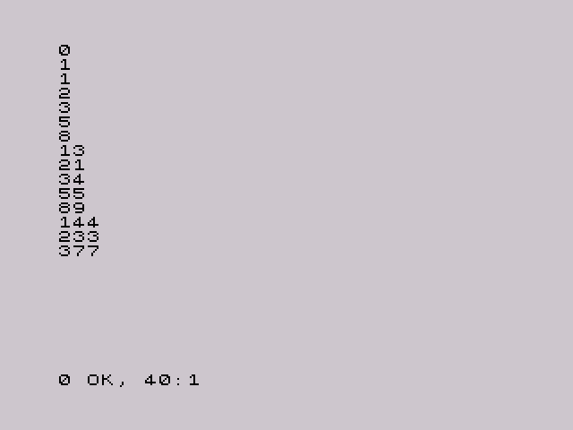

# zx-jvm

A very small JVM for the ZX Spectrum. It reads a real `.class` file produced by `javac`, loaded from tape as a CODE block, and interprets its bytecode on the Z80.

It is basic because of the constraints of the target machine: currently enough to run programs like [`examples/Fibonacci.java`](examples/Fibonacci.java), which prints the first 15 Fibonacci numbers, and to print constant strings.

Of course it was vibecoded.

| [`HelloWorld.java`](examples/HelloWorld.java) | [`Fibonacci.java`](examples/Fibonacci.java) |
|---|---|
|  |  |

## Requirements

- [z88dk](https://z88dk.org/), with `zcc` and `appmake` on your `PATH`
- A JDK, version 11 or newer
- [Fuse](https://fuse-emulator.sourceforge.net/) to run the tapes on an emulated Spectrum
- GNU Make
- Python 3, for the [tests](#tests)

Tested with z88dk 2.0, OpenJDK 17, Fuse 1.6.0, Python 3.11 and SkoolKit 10.2.

## Quick start

```sh
make        # builds build/Fibonacci.tap and build/zx-jvm.tap
make run    # opens build/Fibonacci.tap in Fuse
```

The program prints 0 to 377 and returns to BASIC with `0 OK, 40:1`.

For the classic first program, [`examples/HelloWorld.java`](examples/HelloWorld.java), which prints `Hello world from Java`:

```sh
make run CLASS=HelloWorld
```

## Running your own class

Your class must be in the default package and stay within the [supported features](#what-is-supported).

### Build a complete tape

This is the simplest way, and gives you a tape that loads and runs without any prompt:

```sh
make CLASS=MyProgram JAVA_DIR=path/to/source
```

The result is `build/MyProgram.tap`. To open it in Fuse straight away, use the `run` target with the same arguments.

### Use the JVM-only tape

`build/zx-jvm.tap` contains the JVM without a class. After loading, it shows `Insert class tape, press a key` and then loads the next CODE block as the class.

First, put the class in a tape of its own:

```sh
javac -d build MyProgram.java
appmake +zx --noloader --org 49152 -b build/MyProgram.class --blockname MyProgram -o MyProgram.tap
```

Then do one of the following:

- **Swap tapes:** load `zx-jvm.tap`. At the prompt, open `MyProgram.tap` (F7 in Fuse) and press a key.
- **Join the tapes:** run `cat build/zx-jvm.tap MyProgram.tap > combined.tap` and load the result. You still press a key at the prompt.

The class always loads at 49152, whatever address its block was saved with.

## What is supported

The JVM runs `public static void main(String[])` from one class.

| Area | Supported |
|---|---|
| Constants | `iconst_m1` to `iconst_5`, `bipush`, `sipush`, `ldc` (int and String), `aconst_null` |
| Local variables | `iload`, `istore`, `aload`, `astore` and their `_0` to `_3` forms, `iinc` |
| Arithmetic | `iadd`, `isub`, with 32-bit wraparound |
| Branches | `ifeq`, `ifne`, `iflt`, `ifge`, `ifgt`, `ifle`, all `if_icmp` forms, `ifnull`, `ifnonnull`, `if_acmpeq`, `if_acmpne`, `goto` |
| Return | `return` |
| Runtime | `System.out.print` and `println` of `int` and `String`, and `println()` |

Strings are limited to constants, which can be stored in local variables and compared with `==` and `!=`. As in Java, equal string literals in a class are the same object. Constant expressions such as `"a" + "b"` work because `javac` joins them, but `"x = " + x` needs `invokedynamic` and is unsupported; print the parts separately instead.

Output uses the Spectrum character set, which is close to ASCII:

- `\n` starts a new line.
- `^`, `` ` `` and code 127 print as `↑`, `£` and `?`.
- Other control characters and every non-ASCII character print as one `?` each. Characters outside the Basic Multilingual Plane, such as emoji, print as `??`, because Java stores them as two `char`s.
- Long lines wrap at 32 columns.

The Spectrum has no scrollback. Instead, as in BASIC, output stops at `scroll?` after each screen of new text:

- Any key except N, SPACE and BREAK shows the next screen.
- N, SPACE or BREAK stop the program with `D BREAK - CONT repeats`. `CONT` then runs the program again from the start.

Everything else is unsupported, including multiplication and division, other types, `char` output, string operations, arrays, objects, fields, and calling your own methods. There is no garbage collector, verifier, exception handling or loading of other classes.

Unsupported features stop the program with an error rather than misbehaving:

```
JVM: unsupported opcode 104 at pc 15
JVM: unsupported method java/io/PrintStream.println:(C)V
```

The Spectrum still shows `0 OK` after an error, because the JVM always returns to BASIC normally.

Limits:

- 256 constant pool entries, and each distinct string takes two
- 64 slots for local variables and the operand stack together
- Just under 16 KB for the class file

## How it works

The tape holds a BASIC loader, the JVM and, on complete tapes, the class:

```basic
10 CLEAR 32767
20 LOAD ""CODE
30 LOAD ""CODE 49152
40 RANDOMIZE USR 32768
```

| Address | Contents |
|---|---|
| 32768 | JVM, about 8 KB |
| 49152 | Class file |

The JVM parses the constant pool, finds `main` and interprets its bytecode directly from the class file in memory. Java's `int` is held in a 32-bit `long`, and a reference in the same slot holds a 16-bit address, with `null` as 0.

A string is its `CONSTANT_Utf8` entry in the class file, so strings need no heap or copying. `System.out` is a one-byte object inside the JVM.

Runtime methods are written in C and listed in the `natives` table in `src/zxjvm.c`, with their class, name, descriptor and handler. The first call from each call site looks the method up by name, and later calls reuse the result. To add a method, write a handler and add a row. Output goes through the Spectrum ROM's print routine.

### Compiler pitfalls

The JVM is compiled with sccz80, which miscompiled some valid C in this project. These are worth remembering when changing `src/zxjvm.c`, especially 32-bit code:

| C code | What went wrong | Used instead |
|---|---|---|
| `0UL - v` | Computes `v - 0` | `~v + 1UL` |
| `v % 10UL` | Divides only the low 16 bits of `v` | Subtracting powers of ten |
| `(signed char)` cast of a byte | Loses the sign | The `s1()` helper |

## Tests

```sh
make test               # run all tests
tests/run.sh Edge       # run one test
```

Each test builds a tape and runs it with [`tests/tap2text.py`](tests/tap2text.py), which needs no display. The script uses [SkoolKit](https://skoolkit.ca)'s Z80 simulator to load the tape on an emulated 48K Spectrum, running the ROM's own loader. It then runs the program until BASIC waits for a key, and reads the text from screen memory using the ROM font. At each `scroll?` prompt, it records the screen, adds a `--- key pressed` line and presses ENTER. The test compares the text with a file in `tests/expected/`, and a failure prints a diff. A program that runs for more than 60 seconds of emulated time without reaching a prompt also fails.

| Test | What it covers |
|---|---|
| `Fibonacci`, `HelloWorld` | The example programs |
| `Edge` | Int limits, overflow, negative constants, branches |
| `Scroll` | 32-bit wraparound, a countdown loop, paging through three screens |
| `Strings` | String output, local variables, `null`, non-ASCII and wrapping |
| `LongString` | The `scroll?` prompt caused only by wrapped text |
| `References` | `null` checks and comparing references |
| `BadOpcode` | Error for an unsupported opcode |
| `BadMethod` | Error for an unsupported method, `println(char)` |
| `NoMain` | Error for a class without `main` |

The tests need Python 3 with the `venv` module. `make test` creates a Python environment in `.venv` with the SkoolKit version from `tests/requirements.txt`; you can also create it with `make venv`. To use another interpreter that has SkoolKit installed, set `PYTHON`.

A whole test takes a fraction of a second to run. The tests only cover the 48K Spectrum.

A character cell that matches no character appears as `�` in the text. `build/tests/<name>.png` shows the final screen as an image.

You can also run a single tape yourself:

```sh
.venv/bin/python tests/tap2text.py build/HelloWorld.tap
```

To change what a test expects, edit its text file, or run `tests/run.sh --update Edge` and check the diff before committing it.

## Claude Code skill

[`.claude/skills/zx-spectrum-run`](.claude/skills/zx-spectrum-run/SKILL.md) lets Claude Code run Spectrum programs and see their output. It starts Fuse, loads the program, waits for the screen to settle and saves a screenshot.

You can also run its script directly:

```sh
.claude/skills/zx-spectrum-run/scripts/zx-run.sh --out screen.png build/Fibonacci.tap
```

## Project layout

```
.claude/skills/  Claude Code skill for running programs in Fuse
docs/            Screenshots for this README
examples/        Example Java programs
src/zxjvm.c      The JVM
tools/MkTap.java Builds the tape images
tests/           Test programs, runner, headless tape runner and expected output
build/           Generated files
```

## Status

Tested in Fuse on emulated 48K and 128K machines, but not on real Spectrum hardware.
