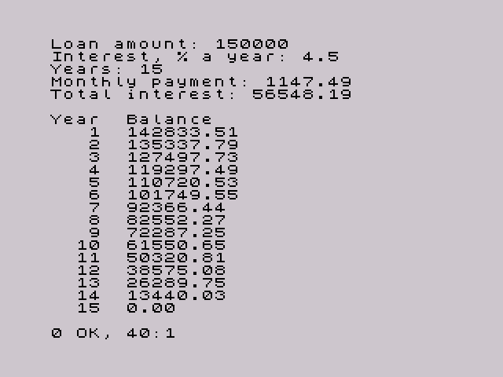

# zx-jvm

A very small JVM for the ZX Spectrum. It reads a real `.class` file produced by `javac`, loaded from tape as a CODE block, and interprets its bytecode on the Z80.

It is basic because of the constraints of the target machine: currently enough to run programs like [`examples/Fibonacci.java`](examples/Fibonacci.java), which prints the first 15 Fibonacci numbers, to print strings, to read lines and numbers with `Scanner` on the input line at the bottom of the screen, and to calculate with `double`, as [`examples/Loan.java`](examples/Loan.java) does for a loan's monthly payments.

Of course it was vibecoded.

[`HelloWorld.java`](examples/HelloWorld.java):


[`Fibonacci.java`](examples/Fibonacci.java):


[`Loan.java`](examples/Loan.java), for a 15-year loan:



## Requirements

- [z88dk](https://z88dk.org/), with `zcc` and `appmake` on your `PATH`
- A JDK, version 11 or newer
- [Fuse](https://fuse-emulator.sourceforge.net/) to run the tapes on an emulated Spectrum
- GNU Make
- Python 3 and a C compiler for the host, such as GCC, for the [tests](#tests)

Tested with z88dk 2.0, OpenJDK 17, Fuse 1.6.0, Python 3.11, SkoolKit 10.2 and GCC 12.

## Quick start

```sh
make        # builds build/Fibonacci.tap and build/zx-jvm.tap
make run    # opens build/Fibonacci.tap in Fuse
```

The program prints 0 to 377 and returns to BASIC with `0 OK, 40:1`.

For the classic first program, [`examples/HelloWorld.java`](examples/HelloWorld.java), which prints `Hello world from Java`:

```sh
make run CLASS=HelloWorld
```

[`examples/Adder.java`](examples/Adder.java) reads input. It asks for your name, then adds up numbers until you enter 0 and shows their count, total and largest value:

```sh
make run CLASS=Adder
```

[`examples/Loan.java`](examples/Loan.java) calculates the monthly payment of a fixed-rate loan from its amount, yearly interest rate and length in years, and lists the balance left after each year:

```sh
make run CLASS=Loan
```

## Running your own class

Your class must be in the default package and stay within the [supported features](#what-is-supported).

### Build a complete tape

This is the simplest way, and gives you a tape that loads and runs without any prompt:

```sh
make CLASS=MyProgram JAVA_DIR=path/to/source
```

The result is `build/MyProgram.tap`. To open it in Fuse straight away, use the `run` target with the same arguments.

### Use the JVM-only tape

`build/zx-jvm.tap` contains the JVM without a class. After loading, it shows `Insert class tape, press a key` and then loads the next CODE block as the class.

First, put the class in a tape of its own:

```sh
javac -d build MyProgram.java
appmake +zx --noloader --org 49152 -b build/MyProgram.class --blockname MyProgram -o MyProgram.tap
```

Then do one of the following:

- **Swap tapes:** load `zx-jvm.tap`. At the prompt, open `MyProgram.tap` (F7 in Fuse) and press a key.
- **Join the tapes:** run `cat build/zx-jvm.tap MyProgram.tap > combined.tap` and load the result. You still press a key at the prompt.

The class always loads at 49152, whatever address its block was saved with.

## What is supported

The JVM runs `public static void main(String[])` from one class.

| Area | Supported |
|---|---|
| Constants | `iconst_m1` to `iconst_5`, `bipush`, `sipush`, `ldc` (int and String), `aconst_null`, `dconst_0`, `dconst_1`, `ldc2_w` (double) |
| Local variables | `iload`, `istore`, `aload`, `astore`, `dload`, `dstore` and their `_0` to `_3` forms, `iinc` |
| Arithmetic | `iadd`, `isub`, `imul`, `idiv`, `irem`, `ineg`, with 32-bit wraparound as in Java; `dadd`, `dsub`, `dmul`, `ddiv`, `dneg` |
| Conversions and comparisons | `i2d`, `d2i`, `dcmpl`, `dcmpg` |
| Branches | `ifeq`, `ifne`, `iflt`, `ifge`, `ifgt`, `ifle`, all `if_icmp` forms, `ifnull`, `ifnonnull`, `if_acmpeq`, `if_acmpne`, `goto` |
| Return | `return` |
| Objects and calls | `new`, `dup`, `dup2`, `pop`, `pop2`, `invokevirtual`, `invokespecial`, `invokestatic`, `getstatic`, only for the runtime classes below |
| Runtime | `System.out.print` and `println` of `int`, `double` and `String`, and `println()`; `new Scanner(System.in)` with `nextLine()`, `nextInt()` and `close()`; `Integer.parseInt(String)`; `Double.parseDouble(String)`; `Double.toString(double)` and `String.valueOf(double)`; `Math.abs`, `Math.max` and `Math.min` of `int` |

Strings are constants or lines read with `Scanner`. They can be stored in local variables and compared with `==` and `!=`. As in Java, equal string literals in a class are the same object. Constant expressions such as `"a" + "b"` work because `javac` joins them, but `"x = " + x` needs `invokedynamic` and is unsupported; print the parts separately instead.

Output uses the Spectrum character set, which is close to ASCII:

- `\n` starts a new line.
- `^`, `` ` `` and code 127 print as `↑`, `£` and `?`.
- Other control characters and every non-ASCII character print as one `?` each. Characters outside the Basic Multilingual Plane, such as emoji, print as `??`, because Java stores them as two `char`s.
- Long lines wrap at 32 columns.

The Spectrum has no scrollback. Instead, as in BASIC, output stops at `scroll?` after each screen of new text:

- Any key except N, SPACE and BREAK shows the next screen.
- N, SPACE or BREAK stop the program with `D BREAK - CONT repeats`. `CONT` then runs the program again from the start.

### Input

`Scanner` reads from the input line at the bottom of the screen, as BASIC's `INPUT LINE` does:

```java
Scanner in = new Scanner(System.in);
System.out.print("Name: ");
String name = in.nextLine();
```

- **Editing:** you edit the line with the Spectrum's own editor, including DELETE and the cursor keys, and press ENTER to finish.
- **Echo:** the line is then copied to the upper screen after the prompt, as a terminal would show it, so the screen keeps a record of the conversation.
- **STOP:** cursor down (CAPS SHIFT + 6) stops the program with `H STOP in INPUT`, as in BASIC.
- **Keywords:** keyword symbols such as `<=` become their text.
- **Other characters:** graphics and user-defined graphics become `?`, and colour controls are dropped.

`Scanner` behaves as on any JVM:

- `nextInt()` skips spaces and empty lines, reads one number and leaves the rest of the line.
- A following `nextLine()` returns that rest, often an empty string, without waiting for input.
- If the input isn't a number in the range of `int`, the program stops with an error, because exceptions are unsupported. Java would throw `InputMismatchException`.

Division by zero stops the program with `JVM: / by zero`, where Java would throw `ArithmeticException`. `Integer.parseInt` accepts what `nextInt()` accepts, without spaces.

### Doubles

`double` follows IEEE 754 exactly, as Java requires. Every result is rounded the same way as on any other JVM, including infinities, NaN, `-0.0` and the smallest (subnormal) numbers. The arithmetic is done in software, so it is slow: on a real Spectrum, an addition takes about 5 ms, a multiplication about 11 ms and a division about 17 ms. `Loan` works a year at a time rather than a month at a time to stay quick.

`System.out.println(d)`, `Double.toString(d)` and `String.valueOf(d)` print a `double` as Java does, except for the number of digits. Java prints as many digits as it takes to tell the `double` apart from its neighbours, up to 17. Finding those exactly needs arithmetic on numbers of up to about 1100 bits, which would take too much code. The JVM rounds to at most 15 significant digits instead, then drops trailing zeros. Any decimal of up to 15 digits, such as anything typed in, prints as written:

| Value | Java | zx-jvm |
|---|---|---|
| `0.1`, `825.37`, `1e-5` | `0.1`, `825.37`, `1.0E-5` | The same |
| `1.0 / 3` | `0.3333333333333333` | `0.333333333333333` |
| `0.1 + 0.2` | `0.30000000000000004` | `0.3` |
| `Double.MAX_VALUE` | `1.7976931348623157E308` | `1.79769313486232E308` |
| `Double.MIN_VALUE` | `4.9E-324` | `4.94065645841247E-324` |

So two different `double`s can print the same, as `0.1 + 0.2` and `0.3` do, which matters when you compare doubles: compare them in the program, not by their printed text. The layout follows Java: from 0.001 up to 10,000,000 without an exponent, as `1234.5`, and otherwise as `1.2345E7`, with at least one digit after the point. In rare cases, when a value is within a thousandth of a unit from halfway between two 15-digit decimals, the last digit is rounded the other way. Printing a number takes about 40 to 60 ms, and up to 125 ms for very large or very small exponents.

Java's `println` doesn't format money: `825.5` prints as `825.5`, not `825.50`, and `String.format` is unsupported. To print a fixed number of decimals, convert to whole units, as `Loan` does for cents:

```java
int cents = (int) (amount * 100 + 0.5);
System.out.print(cents / 100);
System.out.print(cents % 100 < 10 ? ".0" : ".");
System.out.println(cents % 100);
```

To read a `double`, use `Double.parseDouble(in.nextLine())`. `Scanner.nextDouble()` is unsupported. On a desktop, it follows the locale, so in many countries it would expect `4,5` instead of `4.5`; `Double.parseDouble` reads `4.5` everywhere.

`Double.parseDouble` accepts what Java accepts, except for hexadecimal, and rounds correctly. To keep the code small, it supports at most 15 significant digits and powers of ten from -22 to 22, which covers ordinary input. Other numbers stop the program with `JVM: unsupported double`, and text that isn't a number stops it with `JVM: not a double`, where Java would throw `NumberFormatException`.

### Unsupported features

Everything else is unsupported, including other types such as `long` and `float`, `char` output, string operations, arrays, your own objects, fields, and calling your own methods. There is no garbage collector, verifier, exception handling or loading of other classes.

Unsupported features stop the program with an error rather than misbehaving:

```
JVM: unsupported opcode 133 at pc 11
JVM: unsupported method java/io/PrintStream.println:(C)V
JVM: not an int: 12x
JVM: not a double: 1,5
```

The Spectrum still shows `0 OK` after an error, because the JVM always returns to BASIC normally.

Limits:

- 256 constant pool entries, and each distinct string takes two
- 64 slots for local variables and the operand stack together
- Just under 16 KB for the class file and the heap together. Each line read takes its length plus 3 bytes, and memory is never freed, so a program that reads many lines eventually stops with `JVM: out of memory`.

## How it works

The tape holds a BASIC loader, the JVM and, on complete tapes, the class:

```basic
10 CLEAR 25599
20 LOAD ""CODE
30 LOAD ""CODE 49152
40 RANDOMIZE USR 25600
```

| Address | Contents |
|---|---|
| Up to 25599 | BASIC: the loader, the input line and the machine stack, with about 1.8 KB to spare |
| 25600 | JVM, about 21 KB; the build fails if it would reach the class |
| 49152 | Class file |
| After the class file, up to 65367 | Heap |
| 65368 | User-defined graphics, as usual |

The JVM's address is `JVM_ADDR` in the Makefile.

The JVM parses the constant pool, finds `main` and interprets its bytecode directly from the class file in memory. Java's `int` is held in a 32-bit `long`, and a reference in the same slot holds a 16-bit address, with `null` as 0. A `double` takes two slots, as in Java.

The `double` arithmetic is in [`src/double.c`](src/double.c), modelled on [Berkeley SoftFloat](http://www.jhauser.us/arithmetic/SoftFloat.html). It works on 64-bit significands kept as two 32-bit words, because sccz80 has no 64-bit integer type. Its innermost parts, such as the multiplication loop, are in Z80 code, which made them up to five times faster. The C versions of those parts remain for testing on the host. To print a `double`, it scales the number by a power of ten to between 10^14 and 10^15, using 64-bit significands for the powers of ten, and rounds that to an integer, which gives the 15 digits.

Every string has the layout of a `CONSTANT_Utf8` entry. A constant string is its entry in the class file, so it needs no copying, and a line read with `Scanner` is allocated on the heap. `System.out`, `System.in` and `Scanner` objects are one byte that identifies their class.

The runtime is written in C, in three tables in `src/zxjvm.c`:

| Table | Holds |
|---|---|
| `classes` | Classes that `new` can create |
| `fields` | Static fields, such as `System.out` |
| `natives` | Methods and constructors, with their class, name, descriptor and handler |

The first call from each call site looks the method up by name, and later calls reuse the result. To add a method, write a handler and add a row.

Output goes through the Spectrum ROM's print routine. Input calls the ROM's line editor, set up the way the ROM's `INPUT LINE` does it.

### Compiler pitfalls

The JVM is compiled with sccz80, which miscompiled some valid C in this project. These are worth remembering when changing the C code, especially 32-bit code:

| C code | What went wrong | Used instead |
|---|---|---|
| `0UL - v` | Computes `v - 0` | `~v + 1UL` |
| `v % 10UL` | Divides only the low 16 bits of `v` | Subtracting powers of ten |
| `(signed char)` cast of a byte | Loses the sign | The `s1()` helper |
| `s.a[i]`, for an array `a` in a local struct `s` | Ignores the offset of `a` in the struct | A pointer: `p = &s;` then `p->a[i]` |
| `e <= 0`, for an `int` `e` | Tests the sign with a carry flag left over from the previous instruction | `e < 1` |
| `1UL << n` | Computes `n << 1` | Shifts by a constant, or a variable shifted (`x >> n` works) |
| `P[i]`, for a constant pointer `P` such as `((long *)0xC000)` | Ignores `i` | A pointer variable |

## Tests

```sh
make test               # run all tests
tests/run.sh Edge       # run one test
```

Each test builds a tape and runs it with [`tests/tap2text.py`](tests/tap2text.py), which needs no display. The script uses [SkoolKit](https://skoolkit.ca)'s Z80 simulator to load the tape on an emulated 48K Spectrum, running the ROM's own loader. It then runs the program until BASIC waits for a key, and reads the text from screen memory using the ROM font. At each `scroll?` prompt, it records the screen, adds a `--- key pressed` line and presses ENTER.

When the program reads input, the script types the next line of `tests/<name>.in` one key at a time. Python escapes in that file give other keys, such as `\x0c` for DELETE or `\xc7` for the `<=` keyword. Before pressing ENTER, it records the screen with the typed line on it and adds a `--- typed:` line. A test fails if its program wants more input than the file has, or leaves lines unread.

The test compares the text with a file in `tests/expected/`, and a failure prints a diff. A program that runs for more than 60 seconds of emulated time without reaching a prompt also fails.

| Test | What it covers |
|---|---|
| `Fibonacci`, `HelloWorld`, `Adder`, `Loan` | The example programs |
| `Edge` | Int limits, overflow, negative constants, branches |
| `Arithmetic` | Multiplication, division and remainder with every sign and overflow, divisors over 16 bits, `ineg`, the static runtime methods, `parseInt("")` |
| `Doubles` | Each `double` operation, compared with the same expression on constants, which `javac` evaluates itself; infinities, NaN, `-0.0`, subnormals, conversions, `parseDouble` |
| `PrintDoubles` | Printing doubles with and without an exponent, special values, and the differences from Java listed in [Doubles](#doubles) |
| `Scroll` | 32-bit wraparound, a countdown loop, paging through three screens |
| `Strings` | String output, local variables, `null`, non-ASCII and wrapping |
| `LongString` | The `scroll?` prompt caused only by wrapped text |
| `References` | `null` checks and comparing references |
| `Input` | `Scanner` lines and numbers, the echo, DELETE, a keyword, what `nextInt()` leaves for `nextLine()` |
| `InputInts` | Int limits, signs, leading zeros and spaces in input |
| `BadOpcode` | Error for an unsupported opcode |
| `BadMethod` | Error for an unsupported method, `println(char)` |
| `BadInput` | Error for a number out of the range of `int` |
| `BadDouble` | Error for a number with a decimal comma |
| `DivideByZero` | Error for division by zero |
| `NoMain` | Error for a class without `main` |

Before those, `make test` runs two tests of the `double` arithmetic on its own, which `make test-double` also runs:

- [`tests/double/host_test.c`](tests/double/host_test.c) compiles `src/double.c` for the host and compares it with the host's IEEE 754 hardware on special values and a million random operand pairs. The random numbers are chosen so that rounding ties, cancellation, subnormals and overflow all occur. It also compares the 15 digits for printing with the C library's `printf`, which rounds exactly, and reports how many came out the other way because they were almost exactly halfway.
- [`tests/double/z80_test.py`](tests/double/z80_test.py) runs the same code compiled by sccz80, including the Z80 parts, in SkoolKit's simulator, and compares thousands of results with Python's floats and its formatting of them. This catches miscompilations, which the host can't.

The tests need Python 3 with the `venv` module. `make test` creates a Python environment in `.venv` with the SkoolKit version from `tests/requirements.txt`; you can also create it with `make venv`. To use another interpreter that has SkoolKit installed, set `PYTHON`.

A whole test takes a fraction of a second to run. The tests only cover the 48K Spectrum.

A character cell that matches no character appears as `�` in the text. `build/tests/<name>.png` shows the final screen as an image.

You can also run a single tape yourself:

```sh
.venv/bin/python tests/tap2text.py build/HelloWorld.tap
```

To change what a test expects, edit its text file, or run `tests/run.sh --update Edge` and check the diff before committing it.

## Claude Code skill

[`.claude/skills/zx-spectrum-run`](.claude/skills/zx-spectrum-run/SKILL.md) lets Claude Code run Spectrum programs and see their output. It starts Fuse, loads the program, waits for the screen to settle and saves a screenshot.

You can also run its script directly:

```sh
.claude/skills/zx-spectrum-run/scripts/zx-run.sh --out screen.png build/Fibonacci.tap
```

## Project layout

```
.claude/skills/  Claude Code skill for running programs in Fuse
docs/            Screenshots for this README
examples/        Example Java programs
src/zxjvm.c      The JVM
src/double.c     IEEE 754 double arithmetic
tools/MkTap.java Builds the tape images
tests/           Test programs, runner, headless tape runner and expected output
tests/double/    Tests of the double arithmetic on the host and on the Z80
build/           Generated files
```

## Status

Tested in Fuse on emulated 48K and 128K machines, but not on real Spectrum hardware.
